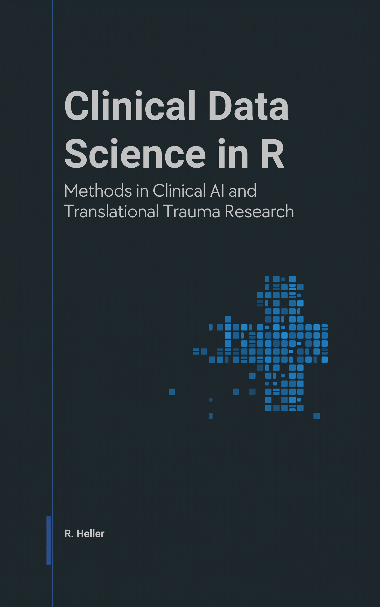

# Clinical Data Science in R



**Methods in Clinical AI and Translational Trauma Research** – a textbook and reference in 28
chapters and seven parts, from the clinical case through model evaluation and complex models to ethics,
regulation, data protection and information security. Every computational chapter contains a complete R lab with
synthetic data and verified target values.

Read online: <https://r-heller.github.io/clinical-data-science-in-r/>

Companion course (eight workshops, 32 teaching units): <https://r-heller.github.io/clinical-data-science-in-r-course/>

## Structure

| Part | Chapters |
|---|---|
| I · The question before the model | B01–B04 |
| II · How models learn and how evidence arises | B05–B08 |
| III · Diagnostics and measurement in four case studies | B09–B12 |
| IV · Complex models for trauma research | B13–B16 |
| V · Care systems and translation into practice | B17–B20 |
| VI · Ethics, law and the protection of data and systems | B21–B24 |
| VII · Special topics and project workshop | B25–B28 |

The chapter number is the fixed identifier (chapter 9 = B09) used by the course and by teaching teams. The chapter
register is in [`editorial/chapter-register.csv`](editorial/chapter-register.csv).

Companion books: [Methods in R](https://r-heller.github.io/methods-in-r/) ·
[Scientometrics in R](https://r-heller.github.io/scientometrics-in-r/) ·
[Strategy in R](https://r-heller.github.io/strategy-in-r/). Further courses:
[CTTIR Courses](https://cttir.github.io/courses/) · [CTTIR Tutorials](https://cttir.github.io/tutorials/).

## Building locally

The project was created with [bookgen](https://github.com/r-heller/bookgen) and keeps its structure
(`_quarto.yml`, `index.qmd`, `chapters/`, `appendices/`, `references.bib`).

Requirements: [Quarto](https://quarto.org/) ≥ 1.10.19 and R ≥ 4.5 with ggplot2, dplyr, tidyr, lme4, deSolve,
glmnet, pROC, dagitty, class, cluster, mclust, simmer, forecast, digest and knitr/rmarkdown (exact versions in the
appendix “Edition notes”).

```sh
quarto render          # HTML and EPUB into _book/
quarto preview
```

R results are stored with `freeze: auto` in `_freeze/`, which is committed; the GitHub Actions build therefore does
not need R. After changing a chapter, render it locally and commit the updated `_freeze/`.

## Data

All examples use synthetic data generated in the chapter with a fixed seed, or explicitly cited published figures.
The repository contains no patient data and no unpublished project results.

## Citation

> Heller, R. (2026). *Clinical Data Science in R: Methods in Clinical AI and Translational Trauma
> Research.* <https://r-heller.github.io/clinical-data-science-in-r/>

## Use of LLM tools

Where applicable, LLM tools were used for narrowly defined, non-authorial tasks: copyediting, prose refinement,
Markdown/LaTeX formatting, boilerplate scaffolding (such as CI configurations and build scripts), and code
refactoring. Tools included [Chat AI](https://kisski.gwdg.de/leistungen/2-02-llm-service/), the KISSKI (GWDG)
service, and self-hosted models served through a local vLLM architecture on an Ubuntu Linux workstation with Intel
processors and NVIDIA GPUs. Self-hosted use also includes models that were further trained (fine-tuned) or
weight-edited in-house for specific tasks. All self-hosted models ran locally, with no data sent to third parties.

All scientific claims, methodological choices, analyses, interpretations and conclusions are the author's own. All
content and references were revised and verified by the author; every reference was checked against its DOI,
ISBN or official source.

## Licence

Text and figures: [CC BY 4.0](https://creativecommons.org/licenses/by/4.0/) (see
[`LICENSE-CONTENT.md`](LICENSE-CONTENT.md)). Code: MIT (see [`LICENSE`](LICENSE)).
